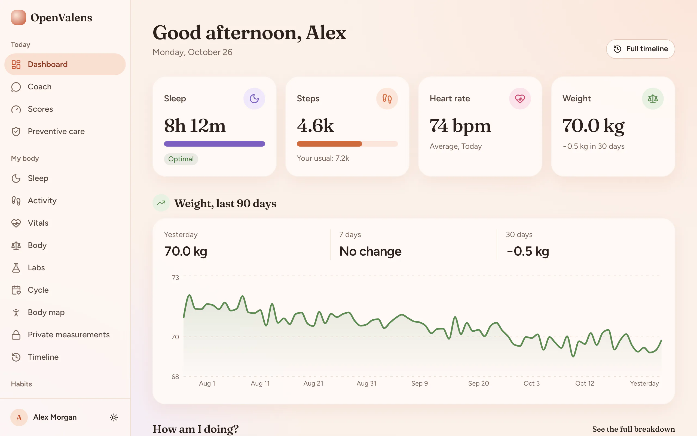
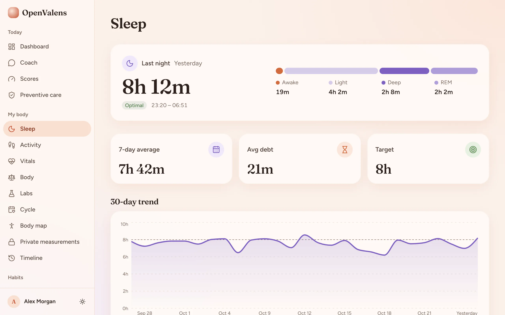
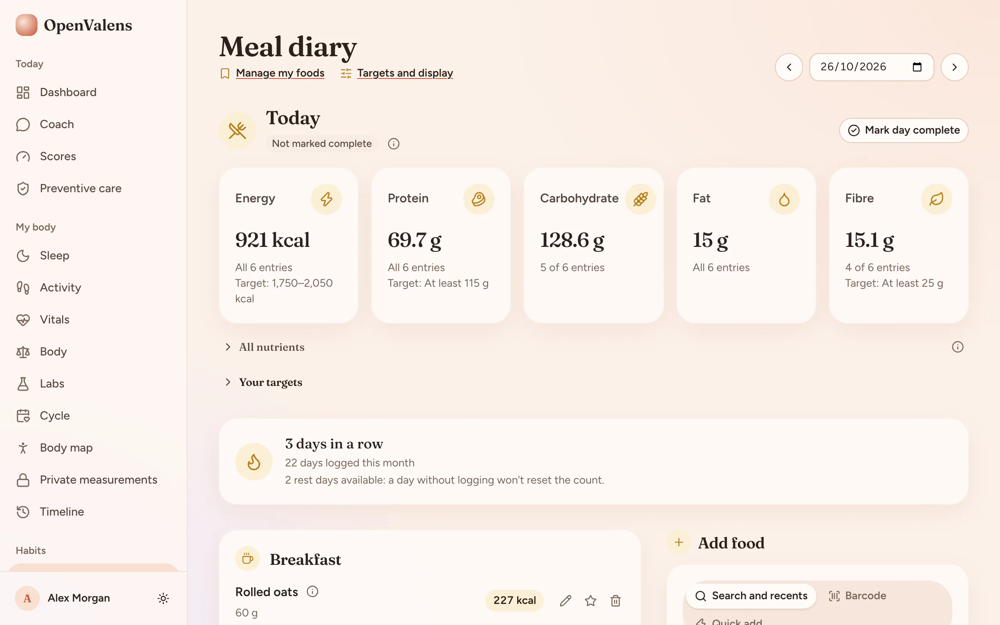
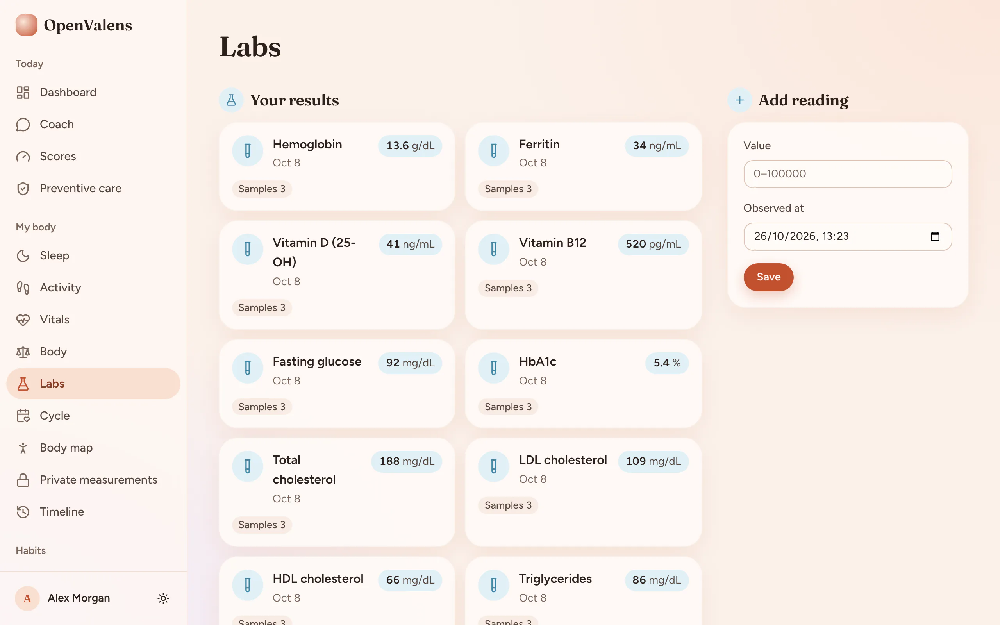
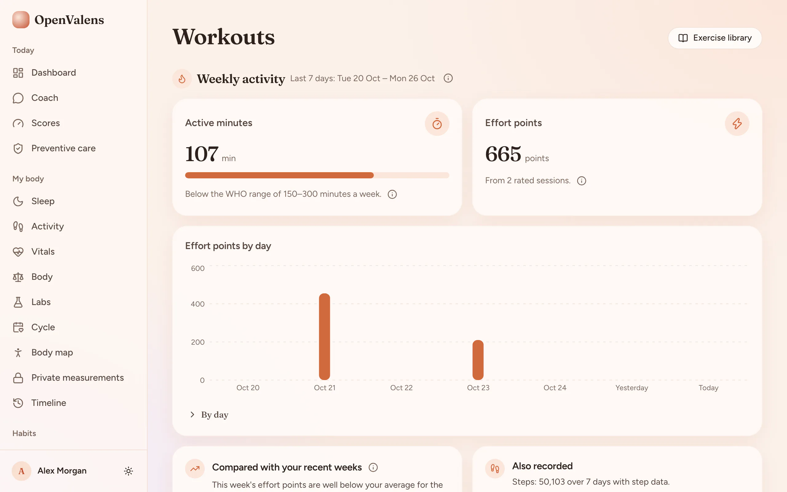
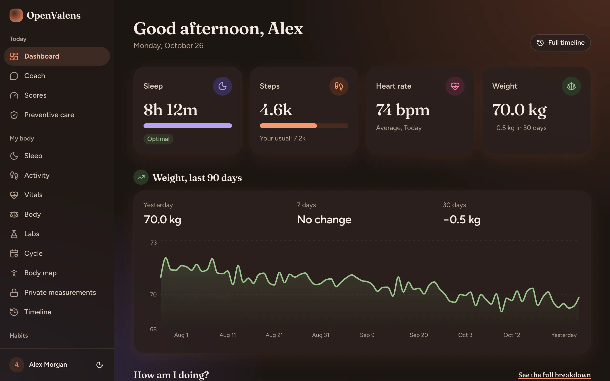
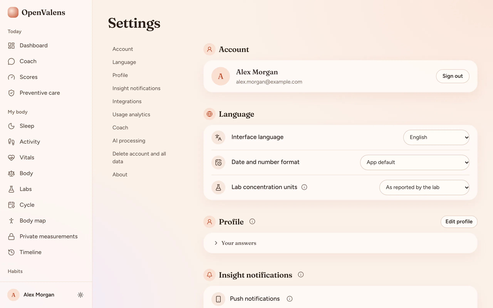

# OpenValens

**Open-source, private health record. Your data stays on your server.**

OpenValens keeps your labs, body measurements, vitals, workouts, nutrition and
sleep in one record that you host yourself: record, organize, visualize and
export it on a server you control. "Open" means open source (AGPL-3.0); it
never means your records are public. An instance has no public sign-up, and
every workspace is invite-only.

> **Beta.** The current version is 0.9.0, the first tagged release
> ([Releases](https://github.com/nip10/openvalens/releases)). Version 1.0.0
> comes with the public store launch.



<table>
  <tr>
    <td width="33%"><br />Sleep</td>
    <td width="33%"><br />Meal diary</td>
    <td width="33%"><br />Labs</td>
  </tr>
  <tr>
    <td width="33%"><br />Workouts</td>
    <td width="33%"><br />Dark mode</td>
    <td width="33%"><br />Settings</td>
  </tr>
</table>

_Every screenshot shows a synthetic demo account ("Alex Morgan", made-up
records), never a real person's data (see [Landing site](#landing-site))._

## What it does

- **Dashboard:** today's sleep, steps, heart rate and weight at a glance, with
  your weight over the last 90 days.
- **Labs:** enter lab results and keep each marker's readings together.
- **Body and vitals:** weight, body measurements and vitals over time.
- **Workouts and activity:** sessions with an effort rating; weekly active
  minutes next to the WHO adult range ([activity load](docs/activity-load.md)).
- **Meal diary:** log meals from public food catalogs (USDA FoodData Central,
  Open Food Facts) that the operator imports
  ([food catalogs](docs/self-hosting/food-catalogs.md)), or from your own
  foods; daily totals show which entries had a value.
- **Sleep, supplements and a timeline** of everything you recorded.
- **Export and delete:** download your record (JSON, CSV or PDF), or delete
  your account and everything you own ([privacy](docs/self-hosting/privacy.md)).
- **Workspaces and sharing** with owner, admin, collaborator and viewer roles.
- **Optional AI assistant,** off by default. When an operator turns it on
  (Anthropic or any OpenAI-compatible endpoint, including a local model) and
  you consent, it can summarise your own records (the Coach screen). It is not medical advice and
  can be wrong ([AI providers](docs/ai-providers.md)).
- A mobile app (`apps/native`) that you build for your own instance.

## What it does not do (yet)

- **Off-site backups are opt-in.** The stack takes encrypted, verified backups
  of the database and stored files daily and before every upgrade, and
  `deploy/setup.sh restore` restores one (deleted accounts stay deleted). They
  stay on the host unless you configure the off-site copy to an S3-compatible
  bucket, and keeping the backup key off the server is up to you
  ([Backups](docs/self-hosting/backup.md)).
- Cloud hosting and public sign-up are not live yet; self-hosting is available.
- No published container images; the install builds from source (#129).
- Mobile apps are not published in the stores yet; wearable vendor connections are available but need provider configuration.

**Intended purpose.** OpenValens is a personal record-keeping and
general-wellness app. It helps you store, organise and view your own
health-related records and track healthy habits. It is not a medical device,
it is not intended to diagnose, screen for, prevent, monitor, predict, treat or
alleviate any disease or condition, and it does not provide medical advice.
Talk to a qualified healthcare professional about your health.

## Where your data goes

Records live in your instance's Postgres database, which has no published
port. There is no analytics or telemetry. The instance only talks to services
you configure: Resend for sign-in codes, invitations and opt-in insight emails;
Let's Encrypt for the HTTPS certificate; and, only if you turn them on, an AI
provider, Open Food Facts barcode lookup, S3-compatible storage, Expo push and
one OIDC provider ([integrations](docs/integrations.md)).

## Quickstart (Docker Compose)

The one supported self-host install is the pinned Compose stack in `deploy/`,
driven by `deploy/setup.sh`. You need a Linux host with Docker Engine, the
Compose v2 plugin and `git`, a domain pointing at it, and a
[Resend](https://resend.com) API key for sign-in email. Read the
[install guide](docs/self-hosting/install.md) and the script before you run
it.

```bash
git clone https://github.com/nip10/openvalens.git
cd openvalens
git checkout v0.9.0          # the newest release tag
deploy/setup.sh install
```

The script generates every secret on the host, starts the stack behind Caddy
(HTTPS) and mints a one-time setup token for the first administrator; the
install guide covers the rest.

## Documentation

### Self-hosting

Run your own instance with the supported Docker Compose install. The guides
apply to OpenValens 0.9.0 (beta):

- [Overview](docs/self-hosting/README.md) — start here; lists what is not covered yet
- [Install](docs/self-hosting/install.md)
- [Configuration](docs/self-hosting/configuration.md) and the generated [environment reference](docs/reference/env.md)
- [Food catalogs](docs/self-hosting/food-catalogs.md) — empty on a new install;
  `deploy/setup.sh catalogs` imports USDA and Open Food Facts data
- [Upgrading](docs/self-hosting/upgrading.md)
- [Backups](docs/self-hosting/backup.md) — encrypted daily and pre-upgrade backups of the database and files, verify, restore; keep the backup key off the server
- [Email](docs/self-hosting/email.md) (Resend only)
- [Single sign-on (OIDC)](docs/self-hosting/oidc.md) — one optional provider, invite-only
- [Google and Apple sign-in](docs/self-hosting/google-apple-sign-in.md) — Continue with Google
  and Apple; sign-up only on OpenValens Cloud
- [Security model and reporting](docs/self-hosting/security.md)
- [Privacy and data rights](docs/self-hosting/privacy.md)
- [Licensing and trademark](docs/self-hosting/licensing.md)
- [Connecting the mobile app](docs/self-hosting/mobile-app.md)
- [AI providers](docs/ai-providers.md) — Anthropic or an OpenAI-compatible endpoint

## Contributing

Contributions are welcome under AGPL-3.0-or-later with a
[DCO](https://developercertificate.org/) sign-off on every commit
(`git commit -s`); there is no CLA. Fixtures, tests and screenshots use
synthetic data only. See [CONTRIBUTING.md](CONTRIBUTING.md) and the
[Code of Conduct](CODE_OF_CONDUCT.md).

## Development

### Getting started

First, install the dependencies:

```bash
bun install
```

### Database setup

This project uses PostgreSQL with Drizzle ORM.

1. Make sure you have a PostgreSQL database set up.
2. Update your `apps/server/.env` file with your PostgreSQL connection details.

3. Start the local database (bound to localhost only) and apply migrations:

```bash
bun run db:start
bun run db:migrate
```

Then, run the development server:

```bash
bun run dev
```

Open [http://localhost:3001](http://localhost:3001) in your browser to see the web application.
Use the Expo Go app to run the mobile application.
The API is running at [http://localhost:3000](http://localhost:3000).

### UI customization

React web apps in this stack share shadcn/ui primitives through `packages/ui`.

- Change design tokens and global styles in `packages/ui/src/styles/globals.css`
- Update shared primitives in `packages/ui/src/components/*`
- Adjust shadcn aliases or style config in `packages/ui/components.json` and `apps/web/components.json`

#### Add more shared components

Run this from the project root to add more primitives to the shared UI package:

```bash
npx shadcn@latest add accordion dialog popover sheet table -c packages/ui
```

Import shared components like this:

```tsx
import { Button } from "@openvalens/ui/components/button";
```

#### Add app-specific blocks

If you want to add app-specific blocks instead of shared primitives, run the shadcn CLI from `apps/web`.

### Environment configuration

Each app owns its environment schema in `.env.schema`. Varlock generates `src/env.ts` during installation; run `bun run env:generate` after changing a schema. Commit schemas, and keep secrets in ignored env files or your deployment platform.

The complete variable list, with types, defaults and `_FILE` support, is generated into [`docs/reference/env.md`](docs/reference/env.md). Regenerate it with `bun run docs:generate` after editing a schema; `bun run docs:check` verifies it in CI.

Import the generated `ENV` accessor in application code. Shared database and auth packages receive configuration or initialized clients from the application. See [Varlock's monorepo guide](https://varlock.dev/guides/monorepos/).

Bun's automatic env loading is disabled in `bunfig.toml`; the framework integration or server bootstrap loads Varlock. Node deployments must include Varlock and its dependencies alongside the app schema.

Run standalone Node/Bun tools that use Varlock from the owning app directory so they load that app's schema and env files. `env:generate` only generates TypeScript files; it does not initialize environment values in a subsequent command.

### Development Docker Compose stack

> This is the **development** stack. To self-host OpenValens on a server, use
> the supported HTTPS install in [docs/self-hosting/](docs/self-hosting/README.md)
> (`deploy/setup.sh install`).

- Target: web + server
- Config: `docker-compose.yml` (app Dockerfiles live in `apps/*/Dockerfile`)
- Build images: bun run docker:build
- Start: bun run docker:up
- Logs: bun run docker:logs
- Stop: bun run docker:down

Environment variables are read from each app's `.env` file (baked into web builds for public variables) and overridden in `docker-compose.yml` for container networking.

For more details, see the guide on [Deploying with Docker Compose](https://www.better-t-stack.dev/docs/guides/docker).

### Formatting

- Run checks: `bun run check`

### Project structure

```
openvalens/
├── apps/
│   ├── web/         # Frontend application (React + TanStack Router)
│   ├── native/      # Mobile application (React Native, Expo)
│   ├── site/        # Static landing site (no third-party requests)
│   └── server/      # Backend API (Hono, ORPC)
├── packages/
│   ├── ui/          # Shared shadcn/ui components and styles
│   ├── api/         # API layer / business logic
│   ├── auth/        # Authentication configuration & logic
│   └── db/          # Database schema & queries
```

### Available scripts

- `bun run dev`: Start all applications in development mode
- `bun run build`: Build all applications
- `bun run dev:web`: Start only the web application
- `bun run dev:server`: Start only the server
- `bun run check-types`: Check TypeScript types across all apps
- `bun run dev:native`: Start the React Native/Expo development server
- `bun run db:migrate`: Apply database migrations (never use `db:push` on real data)
- `bun run db:generate`: Generate database client/types
- `bun run db:studio`: Open database studio UI
- `bun run check`: Run Oxlint and Oxfmt
- `bun run docker:build`: Build the Docker Compose images
- `bun run docker:up`: Build and start the Docker Compose stack
- `bun run docker:logs`: Tail logs from the Docker Compose stack
- `bun run docker:down`: Stop the Docker Compose stack

### Better Auth schema generation

After changing auth plugins or schema options, run `bun run auth:generate` from the project root. The script runs the Better Auth CLI through `varlock run` from the owning app directory, loading the auth instance from `src/services.ts`. Review the schema changes, then use your ORM's migration workflow to apply them.

### Landing site

`apps/site` is the static landing page, in the app's Bloom look
([DESIGN.md](DESIGN.md)): plain HTML, CSS, SVG and WebP screenshots with no
JavaScript, no web fonts and no third-party requests. Headlines use Fraunces
and text uses Figtree only when they are installed on the visitor's device;
otherwise a system serif and sans stack (the CSP has no `font-src`). `bun run --cwd apps/site
build` writes it to `apps/site/dist` (upload that directory to any static
host); the build fails if any page loads a resource from another origin, and
the page carries a strict same-origin Content Security Policy (also written to
`dist/_headers`). `apps/site/scripts/build.test.ts` checks the output, the
banned-wording list and the stated limits in CI.

Screenshots must come from synthetic data only. The ones in
`apps/site/src/screenshots` were captured from a local, disposable instance
whose only account is a synthetic demo account. `bun run demo:seed` creates
that account (Alex Morgan, about 90 days of synthetic data in every module)
deterministically in a disposable `openvalens_demo` database; see
[`packages/demo-seed`](packages/demo-seed/README.md).
`apps/site/scripts/capture-screenshots.ts` documents how to recapture them.

`apps/site/Dockerfile` serves the built site with nginx and the same headers. Set `SITE_APP_URL` to the web app's origin (for example `https://app.openvalens.com`): any path the site does not have is redirected there, so old app links and emailed sign-in links keep working after the app moves to its own subdomain.

## Security

Report vulnerabilities privately as described in [SECURITY.md](SECURITY.md);
please do not open a public issue.

## License

Copyright (C) 2026 The OpenValens contributors.

OpenValens is free software under the [GNU Affero General Public License v3.0 or later](LICENSE), with an [additional permission for app-store distribution](LICENSE-APP-STORE). Contributions are accepted under the same terms with a DCO sign-off; see [CONTRIBUTING.md](CONTRIBUTING.md). The OpenValens name and logo are covered by the [trademark policy](TRADEMARK.md). Report security issues privately as described in [SECURITY.md](SECURITY.md).
